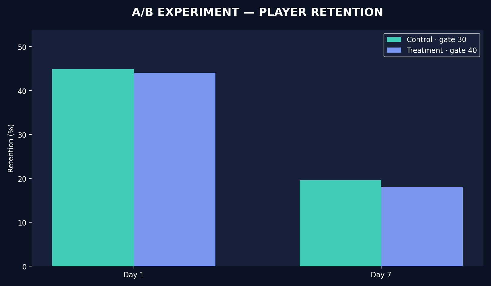

# A/B Testing — Cookie Cats Gate Placement




**Portfolio project 3/3 · Python + SQL + statistical inference + offline interactive dashboard**

## Product decision
Cookie Cats uses progression gates that stop players from immediately moving forward. Does moving the first gate from level 30 (control) to level 40 (treatment) change Day-7 user retention?

## Included
- `data/raw/cookie_cats.csv`: **SYNTHETIC demo experiment** with the exact five fields from the public Cookie Cats dataset. This is **not** the actual 90,189-player dataset.
- `scripts/generate_demo_data.py`: fixed-seed demo generator with 90,000 simulated users.
- `scripts/analyze.py`: schema checks, randomization balance screen (sample ratio mismatch), two-proportion z-test, confidence intervals, and robust engagement medians.
- `sql/experiment_summary.sql`: readable experiment query run by the analyzer in SQLite.
- `outputs/dashboard.html`: self-contained interactive dashboard; open locally.
- `outputs/overview.png`, `outputs/insights.md`, `outputs/experiment_summary.csv`, `outputs/metrics.json`.
- `tests/test_analysis.py`, `notebooks/analysis_walkthrough.ipynb`.

## Run

```bash
python -m pip install -r requirements.txt
python scripts/generate_demo_data.py         # optional, recreates demo CSV
python scripts/analyze.py
python -m unittest discover -s tests -v
```

## Reproduce with actual Cookie Cats public data (recommended)

1. Get [Cookie Cats dataset from Kaggle](https://www.kaggle.com/datasets/mursideyarkin/mobile-games-ab-testing-cookie-cats) (90,189 records). It is also available in public data mirrors, but respect dataset terms.
2. Extract `cookie_cats.csv` and run:

```bash
python scripts/analyze.py --data /path/to/cookie_cats.csv
```

Reports and dashboard will reflect the actual public experiment. The algorithm does not require modification. Do not cite results from the bundled synthetic demo as real experiment effects.

## Metric definitions
- **Primary metric:** Day-7 retention, evaluated at two-sided alpha 0.05.
- **Secondary metrics:** Day-1 retention and median rounds played (exploratory only).
- **Treatment effect:** percentage point difference (gate40 − gate30), not relative lift.
- **Test:** two-proportion z-test, pooled standard error for the null, unpooled Wald 95% CI.
- **SRM check:** chi-squared goodness-of-fit against 50:50 allocation, warning if p<0.01.
- **Unit of analysis:** player, not game round; randomized assignment is assumed, not proven by this CSV.
- **Analysis:** intent-to-treat, including users who may never reach the first gate.

## Product caveats
Statistics are not a substitute for complete product guardrails: the CSV lacks pay conversion, revenue, uninstalls, and actual gate exposure. Do not overclaim causal interpretation if experiment instrumentation / randomization is in doubt.

**Original dataset credit:** Cookie Cats / Tactile Entertainment / public Kaggle dataset. The bundled CSV is independently **synthetic** and contains no real players.

**Resume suggestion (after you understand and execute):** “Evaluated a randomized product-gate experiment using two-proportion z-tests, 95% confidence intervals, and sample-ratio checks, translating Day-7 retention differences into a launch recommendation.”

## Optional one-command public dataset download

Requires internet and dataset access; the bundled synthetic demo works without this. Run `python -m pip install "kagglehub>=1.0.3"`, then `python scripts/download_real_data.py`, then:

```bash
python scripts/analyze.py --data data/real/cookie_cats.csv
```

The download helper saves data under `data/real/` to preserve your demo input. The downloader cannot be network-tested in this package environment.
